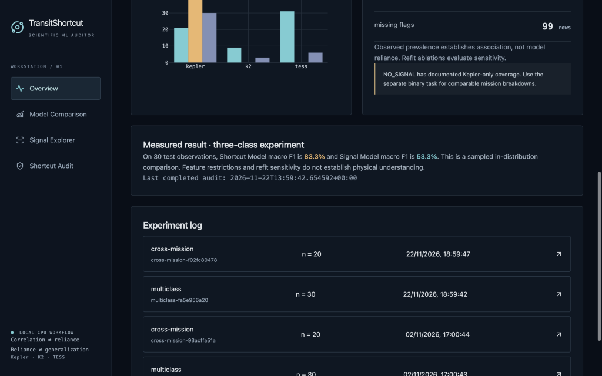
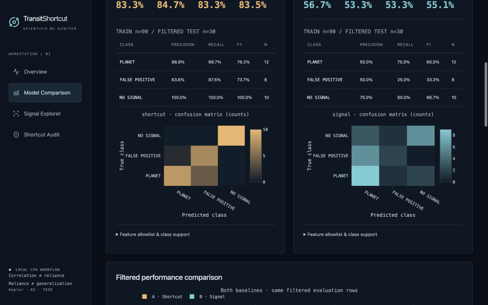
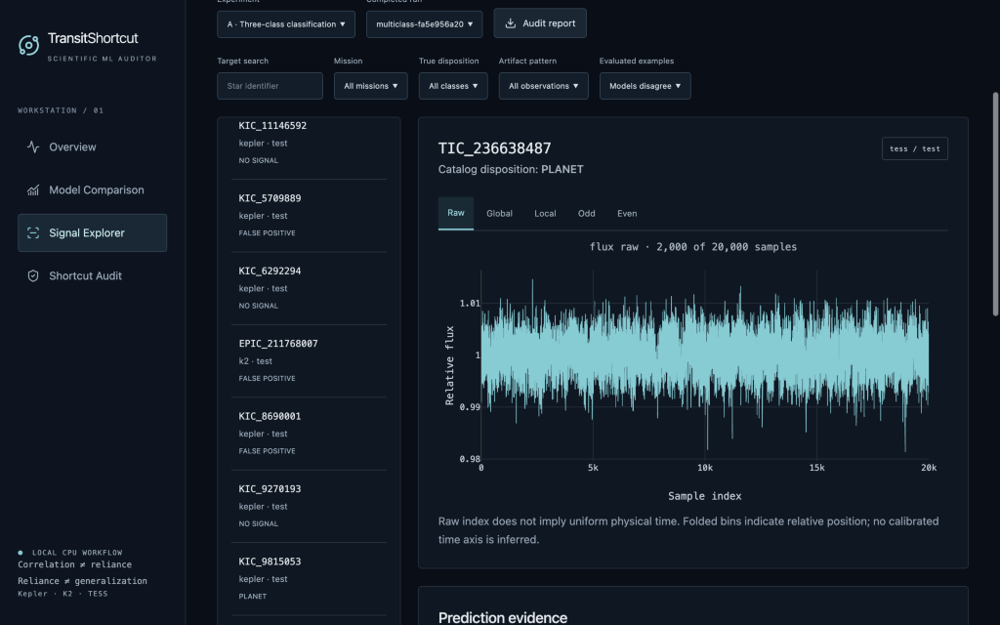
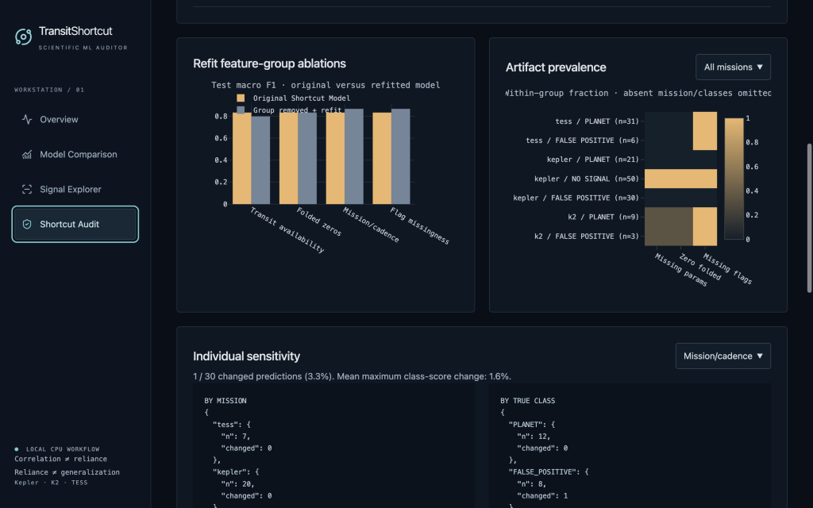
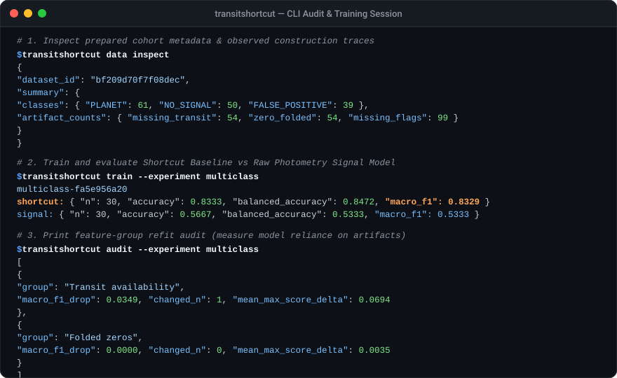

# TransitShortcut

**Is your exoplanet classifier detecting transits... or learning the dataset?**

TransitShortcut audits shortcut learning in machine learning models for exoplanet transit classification. It contrasts a deliberately questionable metadata-only baseline against a raw photometry signal model, quantifies construction artifact prevalence (missing catalog flags, missing transit parameters, zero-padded folded arrays), and executes refit ablations after removing feature groups. Its interactive workstation enables direct inspection of raw light curves, model prediction disagreements, and the underlying evidence behind each audit.

TransitShortcut is scientific evaluation software. It does not discover or validate planets.



---

## Key Features

- **Shortcut vs. Signal Model Comparison**: Directly compares a metadata shortcut model (relying on mission, cadence, parameter availability, folded zeros, and flag missingness) against a raw-photometry signal model (measuring dip depth, variability, negative excursions, asymmetry, and autocorrelation).
- **Interactive Local Workstation**: Built with React and FastAPI to inspect observed cohort composition, per-class metrics, confusion matrices, prediction disagreements, and interactive Plotly light curves.
- **Deep Photometric Explorer**: Examine genuine light curves across 5 views (Raw 20,000 samples, Global phase-folded 201 bins, Local phase-folded 81 bins, Odd-transit 201 bins, Even-transit 201 bins) with extrema-preserving min/max envelope downsampling.
- **Refit Feature-Group Ablations**: Systematically removes feature groups (Mission/cadence, Transit availability, Folded zeros, Flag missingness) from the shortcut model, refits on unchanged training partitions, and measures macro F1 changes and score shifts.
- **Auditable Reproducibility & Exports**: Deterministic cohort sampling with pinned revisions, exact SHA-256 provenance manifests, and multi-format export (`JSON`, `Markdown`, `CSV`).
- **Comprehensive CLI & Offline Mode**: Full feature extraction, model fitting, evaluation, and reporting run synchronously via Typer CLI without external cloud dependencies.

---

## Showcase Gallery

| Overview & Cohort Composition | Model Comparison & Confusion Matrices |
| :---: | :---: |
| [](docs/screenshots/overview.png) | [](docs/screenshots/model-comparison.png) |
| *Cohort composition, active revision, construction traces, and experiment log.* | *Filtered metrics, confusion matrices, and error overlap analysis.* |

| Signal Explorer & Photometry | Shortcut Audit & Ablation Heatmap |
| :---: | :---: |
| [](docs/screenshots/signal-explorer.png) | [](docs/screenshots/shortcut-audit.png) |
| *Raw and folded light curve views, target metadata, and model disagreements.* | *Artifact prevalence heatmap, refit ablations, and score deltas.* |

---

## CLI Demonstration

TransitShortcut includes an offline CLI for training, auditing, and report generation:



---

## Quick Start

### Prerequisites

- **Python**: 3.12+ (3.13 recommended) with [uv](https://docs.astral.sh/uv/)
- **Node.js**: 22.12+ with `pnpm` (via Corepack or npm)
- **Environment**: CPU only; no GPU, API keys, or paid services required.

### Installation & Execution

```sh
# 1. Sync Python dependencies
uv sync --locked --python 3.13

# 2. Build frontend assets
pnpm --dir web install --frozen-lockfile
pnpm --dir web build

# 3. Prepare data sample (150 observation verification cohort)
uv run transitshortcut data prepare --seed 42 --train-size 90 --validation-size 30 --test-size 30 --max-flux-mb 300 --revision 927f66212ecf8acf8a460c6e7efadc6dc8d1b9c7

# 4. Train baseline experiments
uv run transitshortcut train --experiment multiclass
uv run transitshortcut train --experiment cross-mission

# 5. Launch local workstation
uv run transitshortcut serve --host 127.0.0.1 --port 8000
```

Open [http://127.0.0.1:8000](http://127.0.0.1:8000) to access the workstation. FastAPI serves the built frontend alongside the interactive [API documentation](http://127.0.0.1:8000/docs).

For standard larger cohorts:

```sh
# Standard sample: 2,400 / 500 / 500 preserving split distributions
uv run transitshortcut data prepare --mode sample --seed 42
uv run transitshortcut data inspect
```

---

## CLI Commands

| Command | Description |
| :--- | :--- |
| `transitshortcut data prepare` | Download and prepare a revision-pinned, column-projected cohort snapshot. |
| `transitshortcut data inspect` | Print dataset manifest, observed counts, and artifact frequencies. |
| `transitshortcut train --experiment [multiclass\|cross-mission]` | Train Shortcut and Signal models and compute all refit ablations. |
| `transitshortcut audit --experiment [multiclass\|cross-mission]` | Output refit ablation metrics, score deltas, and changed predictions. |
| `transitshortcut report --experiment <name> --format <md\|json\|csv>` | Export full audit reports with verifiable hashes and configurations. |
| `transitshortcut serve --host <ip> --port <port>` | Start the production FastAPI application and workstation UI. |

### Exporting Audits

```sh
# Generate audit reports in multiple formats
uv run transitshortcut report --experiment multiclass --format markdown --output audit.md
uv run transitshortcut report --experiment multiclass --format json --output audit.json
uv run transitshortcut report --experiment multiclass --format csv --output predictions.csv
```

---

## Dataset and Sampling

- **Source**: [bingbangboom/exoplanet-transit-detection](https://huggingface.co/datasets/bingbangboom/exoplanet-transit-detection), by **bingbangboom**, licensed under **CC BY 4.0**.
- **Missions & Classes**: 23,567 observations across NASA Kepler, K2, and TESS, with `PLANET`, `FALSE_POSITIVE`, and `NO_SIGNAL` labels.
- **Light Curve Formats**: Decoded as little-endian float32 arrays:
  - Raw photometry: 20,000 points
  - Global phase-folded: 201 bins
  - Local phase-folded: 81 bins
  - Odd/Even phase-folded: 201 bins each
- **Deterministic Row-Group Sampling**: Reads column-projected Parquet byte ranges via `HfFileSystem` without downloading the full ~1.95 GB dataset. Sampling is stratified by mission/class across seeded row-group clusters, enforcing a compressed flux read cap (`--max-flux-mb 512` default).
- **Validation**: Enforces nonfinite checks, duplicate star identifier detection, and split separation before writing the immutable snapshot.

---

## Models and Experiments

Both pipelines use `scikit-learn` Logistic Regression with fixed `C=1.0`, `max_iter=2000`, and seed-locked reproducibility. Preprocessing (median imputation, standard scaling, one-hot encoding) is fit strictly on **training partitions**.

| Model | Input Feature Family | Excluded Inputs |
| :--- | :--- | :--- |
| **Shortcut Model** | Mission/cadence, transit-parameter presence and missingness (`period_days`, `epoch_bjd`, `duration_hrs`, `depth_ppm`, `planet_radius_earth`), folded-array zero indicators and fractions, catalog false-positive flag missingness. | Star IDs, true disposition, label source, confidence scores, flag values, raw photometry. |
| **Signal Model** | Raw flux variability (standard deviation, MAD, quantiles), dip fraction/width/contrast, negative excursions, asymmetry, window dip minima (widths 5, 21, 51), autocorrelation (lags 1, 10, 50, 200). | Mission, transit parameters, folded arrays, catalog flags, provenance. |

### Evaluation Tasks

1. **A — Multiclass**: Three-class classification (`PLANET`, `FALSE_POSITIVE`, `NO_SIGNAL`) across all missions.
2. **B — Binary Cross-Mission**: Two-class classification (`PLANET` vs. `FALSE_POSITIVE`) evaluated across Kepler, K2, and TESS partitions.
3. **C — Refit Feature Ablations**: Feature groups are removed one at a time and refit on unchanged training rows to assess whether the model relies on specific artifacts or shifts to correlated substitutes.
4. **D — Target Sensitivity**: Row-level comparison of predictions, confidence shifts, and score differences before and after ablation.

---

## Interpretation and Limitations

- **Correlation vs. Sensitivity vs. Generalization**: A strong artifact correlation does not imply model reliance; refit sensitivity demonstrates model reliance within this pipeline, but does not prove scientific generalization.
- **NO_SIGNAL Coverage**: `NO_SIGNAL` is Kepler-only in the published dataset. It has real raw photometry, but missing transit parameters and zero-filled folded views.
- **Non-Exclusive Artifacts**: Zero-filled folded views also occur for `PLANET` and `FALSE_POSITIVE` targets with incomplete catalog solutions.
- **Photometry Proxies**: Raw sample indices reflect acquisition cadence rather than calibrated physical time. Features are heuristic proxies, not a physical transit period search.
- **Uncalibrated Scores**: Output probabilities represent logistic sigmoid estimates and should not be treated as calibrated physical confidence.

---

## Verification & Development

Run the complete automated test suite and linters locally:

```sh
# Backend test suite (18 unit, science, and CLI tests)
uv run pytest -q

# Code quality and formatting checks
uv run ruff check src tests
uv run ruff format --check src tests

# Frontend unit tests (Vitest + React Testing Library)
pnpm --dir web test

# Frontend production compilation
pnpm --dir web build
```

---

## Architecture Overview

```text
transit-shortcut/
├── src/transitshortcut/
│   ├── cli.py             # Typer command-line interface
│   ├── api.py             # FastAPI REST endpoints and static file server
│   ├── data.py            # Parquet range decoding, sampling, validation
│   ├── features.py        # Shortcut and raw-photometric feature extraction
│   └── experiments.py     # Train-isolated pipelines, metrics, refit ablations
├── web/
│   ├── src/main.tsx       # React workstation UI (Overview, Comparison, Explorer, Audit)
│   ├── src/style.css      # Observatory dark theme styling
│   └── src/App.test.tsx   # Frontend component and integration tests
├── tests/
│   ├── conftest.py        # Isolated synthetic test fixtures
│   ├── test_science.py    # Metric validity, decoders, leakage, ablations
│   ├── test_api.py        # REST API endpoints, downsampling, filtering
│   └── test_cli.py        # CLI execution, report exports, error handling
└── docs/
    ├── screenshots/       # Authentic UI screenshots and CLI demonstration
    └── findings.md        # Documented baseline measurements and provenance
```

---

## Attribution

- **Dataset**: [bingbangboom/exoplanet-transit-detection](https://huggingface.co/datasets/bingbangboom/exoplanet-transit-detection) under [CC BY 4.0](https://creativecommons.org/licenses/by/4.0/).
- **Scientific Credits**: NASA Kepler, K2, TESS, [MAST](https://archive.stsci.edu/), [NASA Exoplanet Archive](https://doi.org/10.26133/NEA4), [Lightkurve](https://ascl.net/1812.013), [Thompson et al. (2018)](https://doi.org/10.3847/1538-4365/aab4f9), [Shallue & Vanderburg (2018)](https://doi.org/10.3847/1538-3881/aa9e09), [Ricker et al. (2015)](https://doi.org/10.1117/1.JATIS.1.1.014003), and [Howell et al. (2014)](https://doi.org/10.1086/676406).

```bibtex
@dataset{exoplanet_transit_detection_dataset,
  author = {bingbangboom},
  title = {Exoplanet Transit Detection Dataset},
  year = {2026},
  url = {https://huggingface.co/datasets/bingbangboom/exoplanet-transit-detection},
  note = {Multi-mission dataset (Kepler, K2, TESS) with NO_SIGNAL class},
  license = {CC-BY-4.0}
}
```


## License & Custom Work

[](mailto:work@withrana.com) [](https://www.linkedin.com/in/workwithrana)
[](https://www.upwork.com/freelancers/~01bbcf6edb91a8df5f)
[](https://contra.com/ranajahanzaib/)

**License:** MIT, see [LICENSE](LICENSE). Free for personal and commercial use.

**Author:** Rana Jahanzaib

**Need this built for your stack?** Email me what you're working on: work@withrana.com
